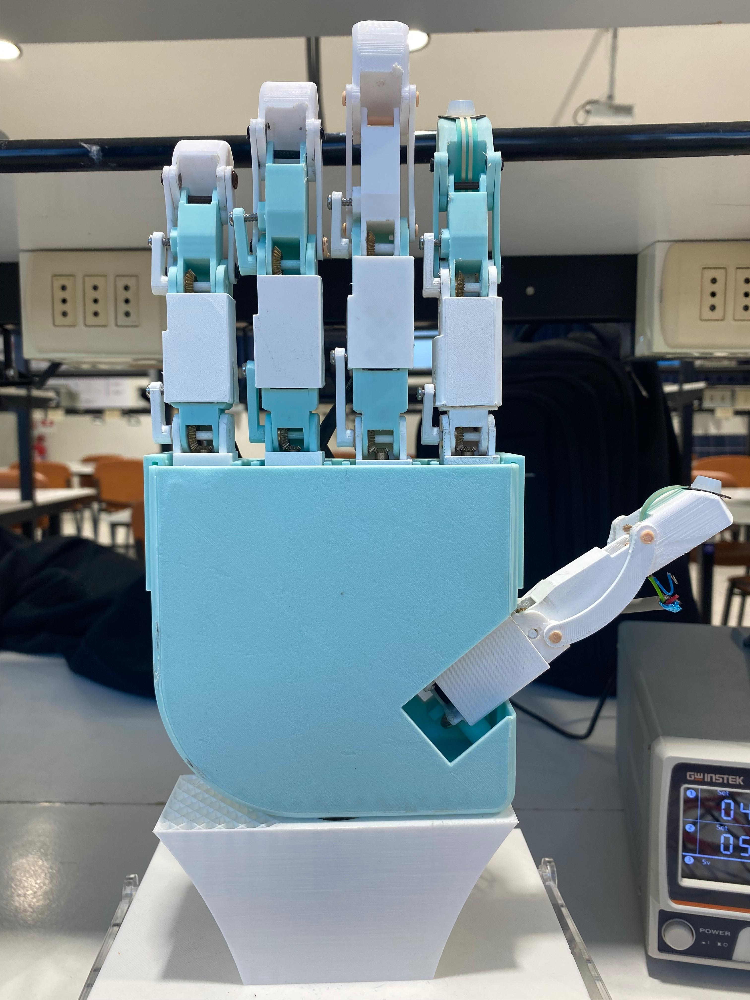

# Design and Bench Evaluation of a Low-Cost Robotic Hand with Mechanically Coupled Distal Joints

[](https://doi.org/10.5281/zenodo.23627235)

This repository accompanies the paper **"Design and Bench Evaluation of a Low-Cost Robotic Hand with Mechanically Coupled Distal Joints"** (L. Muñoz and M. Fernández-Fernández, Universidad de Talca), submitted to IEEE ICA-ACCA 2026. It contains the mechanical design files, embedded firmware, MATLAB/Simulink/Simscape Multibody models and scripts, and the experimental datasets associated with the paper.

<p align="center">
  
</p>

The hand is a laboratory platform for pre-prosthetic grasping research. It is a research prototype, not a clinically validated prosthetic device.

## Overview

| Feature | Value |
|---|---|
| Fingers | 5 |
| Represented joint angles | 15 |
| Actuated axes | 10 (MCP and PIP of each long finger; thumb opposition/abduction and MCP flexion) |
| Mechanically coupled distal joints | 5 (four-bar linkages: DIP follows PIP in the long fingers; IP follows MCP flexion in the thumb) |
| Actuation | N20 DC gearmotors with incremental encoders, bevel-gear transmission |
| Controller board | STM32F767ZI |
| Position control | Discrete LQR state feedback, nominal 50 Hz |
| Contact sensing | Two FSRs (thumb and index fingertips), threshold-based motion inhibition |
| Fabrication | 3D printing |
| Materials/equipment budget | Approximately USD 450 (see paper, Table VI) |

The five distal angles are constrained by the linkage geometry and are not independent degrees of freedom. Encoders are available only for the ten actuated axes; distal angles are inferred from the four-bar constraint and were not measured independently.

## Bench grasp results

Three grasp patterns were tested with three objects per pattern and five attempts per object. An attempt was successful when the hand reached the intended configuration and retained the unsupported object for at least 10 s without visible slip, assessed visually.

| Grasp pattern | Successful attempts |
|---|---:|
| Lateral pinch | 15/15 |
| Pinch | 9/15 |
| Cylindrical grasp | 3/15 |

Per-object outcomes are reported in Table IV of the paper and in `data/Test_Hand.xlsx`. These results are specific to the tested objects and bench conditions; they are not standardized benchmarks.

## Repository structure

```text
├── README.md
├── cad/        Autodesk Inventor project and STL files for 3D printing
├── firmware/   STM32CubeIDE project for the STM32F767ZI controller
├── matlab/     MATLAB scripts and the MATLAB project with the Simscape
│               Multibody grasp models
├── data/       Motor step test, FSR calibration and bench grasp trials
└── docs/       Images used in the documentation
```

Each folder has its own `README.md` with contents, usage notes and limitations.

## Where to find each part of the paper

| Paper content | Location |
|---|---|
| Mechanical design (Sec. II, Figs. 1–2, Table I) | `cad/` |
| Four-bar kinematics and hand kinematics (Sec. II) | `matlab/script/` |
| Encoder vs. AS5600 comparison (Sec. III-A) | `matlab/script/graficar_motorN20.m`, `matlab/script/datos_motor.mat` |
| FSR characterization (Sec. III-A, Eq. 3) | `data/FSR.xlsx` |
| Motor identification and LQR design (Sec. III-B, Eqs. 4, 5, 7, 8) | `matlab/script/LQR_motorV2.m`, `data/escalon_motor2.csv` |
| Embedded control and grasp execution (Sec. III, Fig. 3, Eqs. 2, 6, 9) | `firmware/` |
| Simscape Multibody simulations (Sec. IV, Table III) | `matlab/simulink/` |
| Bench trials (Sec. IV–V, Tables II, IV, V) | `data/Test_Hand.xlsx` |
| Budget (Table VI) | `data/Budget.xlsx` |

## Experimental data summary

- **Encoder vs. AS5600.** An isolated gearmotor was commanded to 10°, 20°, 30°, 45°, 60°, 75° and 90° in ascending order, with the position loop at 50 Hz and recording at 10 Hz for approximately 8 s per target. Error (incremental encoder minus AS5600) over the seven steady-state pairs: mean bias −0.31°, MAE 1.77°, RMSE 2.81°, maximum absolute error 6.43°. Reverse-motion hysteresis and assembled-joint accuracy were not evaluated.
- **FSR calibration.** Six known loads (approximately 1.27–2.26 N), 12-bit ADC, 1 kΩ divider resistor: F = 1.767 × 10⁻³ · N_ADC − 1.087 N, R² = 0.982. Single ascending sequence; valid only within the tested range.
- **Motor identification.** PWM steps of 0, 1000, 2000, 3000 and 4000 counts; 699 input–velocity pairs; first-order model estimated with `ssest` (99.81% fit on the identification data, no independent validation set). Timestamps are MATLAB serial reception times; uniform Ts = 0.02 s was assumed.
- **Bench grasp trials.** Outcomes, peak raw FSR readings and final encoder-derived joint angles for all 45 attempts. FSR values are raw ADC counts; all are below the calibrated range and the 1500-count stop threshold, so they are not force measurements.

## Software and hardware

The files were developed and run with the following versions. Other versions have not been tested.

| Software | Version | Used for |
|---|---|---|
| MATLAB | R2025a (25.1), Windows 11 Pro | All scripts and models |
| Simulink, Simscape, Simscape Multibody | R2025a | Grasp simulation models |
| System Identification Toolbox, Control System Toolbox | R2025a | `LQR_motorV2.m` (`ssest`, `c2d`, `dlqr`) |
| Statistics and Machine Learning Toolbox | R2025a | `graficar_motorN20.m` (`normpdf`) |
| Simscape Multibody Link | R2025a | CAD export from Inventor 2021 to Simscape Multibody |
| Autodesk Inventor Professional | 2026 (Build 175, Release 2026.0.1) | Drawings, assemblies and renderings |
| Autodesk Inventor Professional | 2021 (Build 183) | Base model for export to Simscape Multibody |
| STM32CubeIDE | 1.19.0 | Firmware build and flashing |

Two Inventor releases were used. Inventor 2026 was used for drawings, assemblies and renderings. Inventor 2021 was used for the base model exported to Simscape Multibody through the Simscape Multibody Link plug-in, because the plug-in was only available for Inventor up to the 2021 release. Inventor files cannot be opened in a release older than the one that last saved them.

Physical testing requires the STM32F767ZI board, H-bridge drivers, ten N20 encoder gearmotors, two FSRs and the printed hand, as described in the paper and in `firmware/README.md`.

## Limitations

The reported study does not establish:

- Contact-driven passive adaptation of the fingers.
- Superiority over alternative position controllers.
- Experimentally validated simulated contact forces.
- FSR-triggered stopping or closed-loop force regulation (neither FSR reached its threshold during the trials).
- Clinical effectiveness, safety or suitability as a prosthetic device.

Simulation and bench conditions were not fully matched: joint targets were adjusted during testing and some physical objects differed from the virtual ones.

## Citation

If you use this repository, please cite both the paper and the archived repository.

**Paper.** Final bibliographic details (pages, DOI) will be added after publication.

```bibtex
@inproceedings{munoz2026robotichand,
  author    = {Mu{\~n}oz, Luis and Fern{\'a}ndez-Fern{\'a}ndez, Mario},
  title     = {Design and Bench Evaluation of a Low-Cost Robotic Hand with Mechanically Coupled Distal Joints},
  booktitle = {IEEE International Conference on Automation / XXVII Congress of the Chilean Association of Automatic Control (ICA-ACCA)},
  address   = {Concepci{\'o}n, Chile},
  year      = {2026}
}
```

**Repository.** Version 1.0.0 is archived in Zenodo: [10.5281/zenodo.23627235](https://doi.org/10.5281/zenodo.23627235).

```bibtex
@software{munoz2026robotichand_repo,
  author    = {Mu{\~n}oz, Luis and Fern{\'a}ndez-Fern{\'a}ndez, Mario},
  title     = {Low-cost robotic hand with mechanically coupled distal joints: CAD, firmware, MATLAB/Simulink models and bench-test data},
  version   = {1.0.0},
  publisher = {Zenodo},
  year      = {2026},
  doi       = {10.5281/zenodo.23627235},
  url       = {https://doi.org/10.5281/zenodo.23627235}
}
```

## Acknowledgments

The authors acknowledge the support of the Laboratorio de Mecatrónica Agroindustrial (LaMAI) at Universidad de Talca.

## License

| Content | License |
|---|---|
| Source code written by the authors: `firmware/Core` user code, `matlab/script/*.m`, `matlab/simulink/script/` | [MIT](LICENSE) |
| All other original content: CAD, STL and STEP files, Simulink models, datasets, spreadsheets and images | [CC BY-NC 4.0](https://creativecommons.org/licenses/by-nc/4.0/) |

Third-party content keeps its own license and is not covered by the above:

- `firmware/Drivers/`: Arm CMSIS (Apache-2.0) and STMicroelectronics HAL (BSD-3-Clause); see the `LICENSE.txt` files in each folder.
- Files and code sections generated by STM32CubeMX/STM32CubeIDE that carry an STMicroelectronics copyright notice.
- The N20 gearmotor CAD model by Steve Hentschke, from the [GrabCAD Library](https://grabcad.com/library/n20-mini-micro-metal-gear-motor-with-encoder-1), subject to the GrabCAD terms of use.

See [`LICENSE`](LICENSE) for the full terms.
